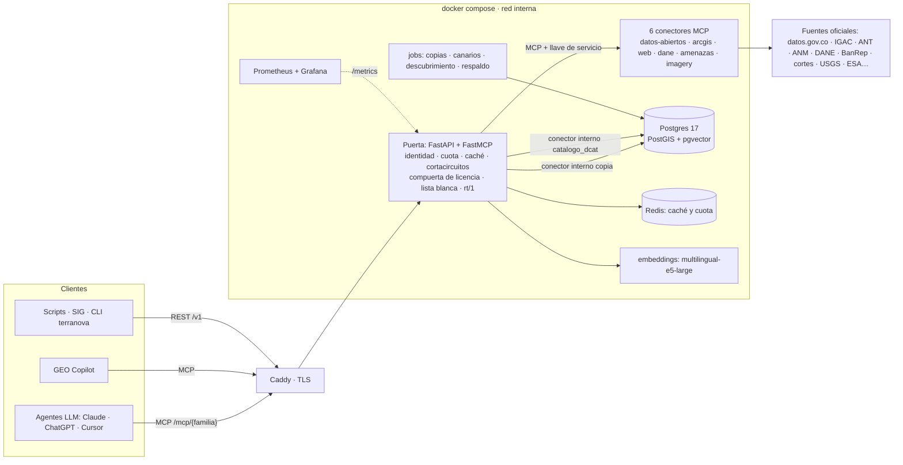

# Arquitectura

- **Clientes.** MCP (streamable HTTP) en `/mcp` o un perfil por familia (`/mcp/territorio`…,
  ADR-0006) y REST `/v1` con OpenAPI 3.1. Los dos se generan del mismo catálogo (ADR-0004).
- **Puerta.** Identidad (llave → organización → plan → scopes, ADR-0009), cuota y medición
  (ADR-0010), errores RFC 9457 (ADR-0011), caché con la frescura de la ficha, cortacircuitos por
  fuente, compuerta de licencia por ítem (ADR-0019), lista blanca de campos (ADR-0014) y el sobre
  `rt/1` (ADR-0005). **No usa LLM** (ADR-0012): la lógica de cada fuente vive en
  `catalogo/fuentes/` y `catalogo/herramientas/` (ADR-0007).
- **Conectores.** Los 6 servicios MCP están vendorizados en `conectores/` (con `geo_mcp_kit`) y
  corren en la red interna sin puerto publicado (ADR-0002). Dos conectores son internos de la
  puerta: `copia` (SQL parametrizado sobre las copias, ADR-0024) y `catalogo_dcat` (el buscador del
  catálogo, ADR-0028).
- **Modos de una fuente** (ADR-0008): `en_vivo` por su conector; `copia` cuando la fuente bloquea al
  servidor, es lenta o no busca en texto (esquema `copia` de Postgres, con manifiesto y `obsoleto`
  al pasar su SLA); `curado` para datasets propios versionados.
- **Descubrimiento (G6).** La cosecha de datos.gov.co y del Hub de la ICDE se embebe con
  multilingual-e5-large y vive en `descubrimiento.datasets` (pgvector + texto). `catalogo_buscar`
  combina los dos por RRF con un piso de similitud medido.
- **Operación.** Jobs diarios en el mismo compose: `copias` (`--solo-vencidas`), `canarios` (una
  verdad medida por herramienta, ADR-0013), `descubrimiento` y `respaldo`. Prometheus evalúa los SLO
  de la spec 05 y Grafana los muestra, solo en la máquina (perfil `observabilidad`).
- **Despliegue.** Una sola VPS con todo el compose (ADR-0030). Caddy es lo único expuesto.

**Repo privado (ADR-0001, enmienda del 2026-10-28):** Terrnova es un producto comercial. El repo
mantiene la higiene de uno público (ni secretos ni datos personales). Cada dato servido conserva la
licencia y la atribución de su fuente. Lo que da valor, además del catálogo, es **operarlo**: mantener
las fuentes al día, con canarios verdes, copias frescas y respuesta a las caídas.
